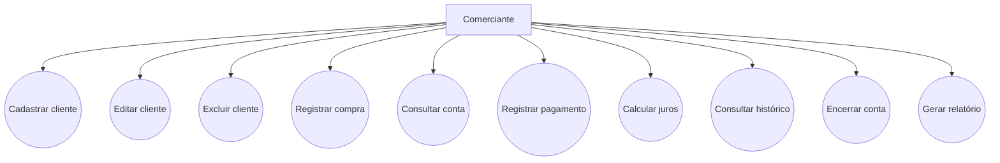
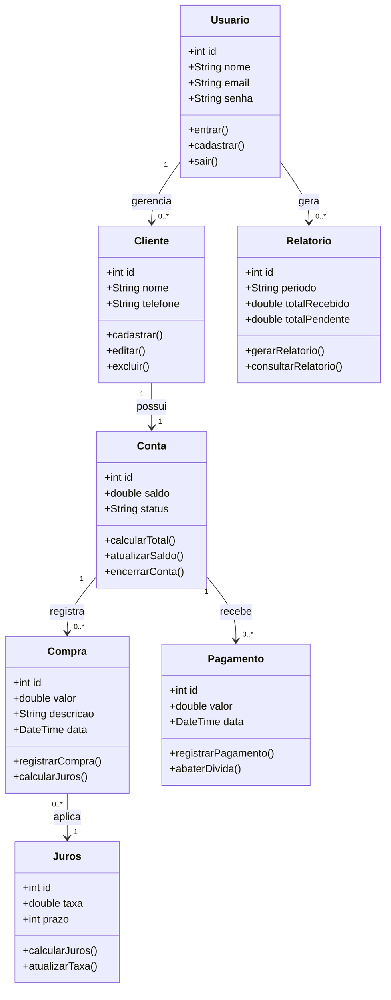

# projetoDisciplina

1. Título
Meu Bolso – Aplicativo de Controle Financeiro Pessoal

2. Equipe
- Integrante 1: Marcus Luan Alves Pinheiro
  
3. Objetivo
Desenvolver um aplicativo mobile que ajude os usuários a organizar suas finanças pessoais, permitindo registrar entradas e saídas de dinheiro, acompanhar gastos e visualizar o saldo disponível.

O objetivo principal é facilitar o controle financeiro e ajudar as pessoas a terem mais consciência sobre como utilizam seu dinheiro.

4. Público-alvo
O aplicativo será destinado a:
- Estudantes.
- Jovens que estão começando a administrar o próprio dinheiro.
- Pessoas que desejam controlar seus gastos.
- Trabalhadores que querem organizar suas finanças pessoais.
  
5. Requisitos
Requisitos funcionais
1. Permitir cadastro e identificação do usuário.
2. Permitir registrar entradas de dinheiro.
3. Permitir registrar despesas.
4. Permitir editar e excluir lançamentos.
5. Exibir o saldo total disponível.
6. Organizar despesas por categorias.
7. Mostrar histórico de movimentações.
8. Exibir relatórios de gastos.
   
Requisitos não funcionais
1. Interface simples e intuitiva.
2. Aplicativo compatível com Android.
3. Armazenamento seguro dos dados.
4. Bom desempenho durante a utilização.
5. Facilidade de manutenção e atualização.

## Diagrama de Casos de Uso

## Diagrama de Classes

7. Organização da equipe para desenvolvimento
Marcus Luan Alves Pinheiro
Desenvolvimento das telas e interface
Cadastro e gerenciamento das movimentações
Banco de dados, relatórios e testes
